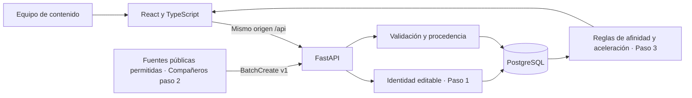

# Arquitectura del prototipo

## Decisiones para iniciar rápido

- Monorepo con backend y frontend independientes. Los compañeros pueden implementar adaptadores del paso 2 sin tocar la identidad ni el ranking.
- Esquemas Pydantic estrictos como contrato compartido. Persistencia SQLAlchemy y migraciones Alembic; las tablas almacenan brief, identidad y lotes versionados como JSON. Diseño simple para el hackathon; si crece el volumen, normalizar piezas y observaciones para consultas e índices.
- PostgreSQL en Compose, SQLite opcional para pruebas y desarrollo. Las migraciones son explícitas, no se crean tablas durante cada petición.
- Docker multietapa para React y Nginx con proxy `/api`. Backend con usuario sin privilegios. PostgreSQL usa su imagen oficial y volumen nombrado.
- El paso 1 usa `app/brightdata.py` como recolector principal y `app/profiles.py` para seleccionar Meta/YouTube como respaldo. Guarda el JSON normalizado en `profile_analyses` y propone identidad por reglas. La migración 003 agrega `profile_collection_jobs`: reserva persistente antes del POST, snapshot y resultado para retomar sin duplicar la extracción. La revisión humana conserva la autoridad sobre identidades confirmadas.
- Bright Data se consulta mediante su API fija para perfiles Instagram y canales YouTube. Las URLs se validan y sus identificadores se traducen a endpoints fijos del proveedor o de las APIs oficiales; el backend no visita enlaces arbitrarios. Los trabajos pendientes se consultan desde la UI; no hay un worker separado. Una extracción terminada solo se renueva con solicitud explícita. El paso 2 continúa separado y debe garantizar las condiciones de uso de sus fuentes.

## Evolución sugerida después de integrar

1. Probar paso 2 con una fuente autorizada y pocos temas canónicos. No inventar vistas cuando una API no las exponga; evolucionar el contrato para otras métricas por separado.
2. Recopilar al menos tres observaciones por pieza en intervalos comparables y comparar contra referencias del mismo formato/plataforma.
3. Validar editorialmente las recomendaciones con 30X; registrar decisiones y resultados de experimentos.
4. Incorporar un modelo para extracción temática y explicaciones, con salida estructurada, referencias y revisión humana. Medir su costo por informe.
5. Agregar autenticación, límites, eliminación/retención, paginación e ingesta asíncrona antes de compartir una instancia pública.

No se estima saturación con los datos actuales: falta un denominador de cobertura y diversidad de publicaciones/fuentes. El momento, alcance original de la cuenta y distribución pagada tampoco están disponibles.
