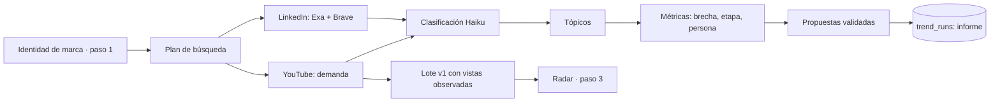

# Radar de tendencias LinkedIn + YouTube · paso 2

Módulo de descubrimiento para LinkedIn y YouTube. Toma la identidad guardada de la marca (paso 1) y responde **qué temas crecen en su mercado, dónde la audiencia pide más de lo que se publica y qué conviene publicar esta semana**, con la evidencia de cada afirmación. Funciona para cualquier marca; 30X es el ejemplo de referencia.

En la interfaz: **Descubrimiento → ¿Dónde buscamos?** Instagram usa la búsqueda de creadores existente. LinkedIn y YouTube, solos o combinados, usan este radar.

## Modos según la red elegida

Solo se consultan las redes elegidas; cada combinación tiene su propio historial de corridas.

| Selección | Qué se consulta | Prioridad (señal de oportunidad) | Propuestas |
| --- | --- | --- | --- |
| LinkedIn | Exa (+ Brave) | Temas cuyas publicaciones crecen con pocos autores | LinkedIn: post, carrusel, video, artículo, encuesta, documento |
| YouTube | YouTube Data API | Demanda × rendimiento frente a lo normal de cada canal | YouTube: video o short |
| LinkedIn + YouTube | Ambas | Brecha demanda (YouTube) − oferta (LinkedIn) | La red que mejor encaje en cada caso |

LinkedIn no expone vistas ni reacciones, así que en modo solo LinkedIn la demanda no se mide (los tópicos quedan "sin validar"). Para la brecha demanda/oferta hay que combinar ambas redes.

## Fuentes (solo APIs oficiales)

| Fuente | Rol | Qué aporta | Clave |
| --- | --- | --- | --- |
| YouTube Data API v3 | Sensor de demanda (siempre activo) | Vistas, likes, comentarios, línea base de cada canal, observaciones cada 6 h | `YOUTUBE_API_KEY` |
| Exa | Oferta en LinkedIn | Posts públicos indexados: URL, autor visible, texto, fecha exacta | `EXA_API_KEY` |
| Brave Search (opcional) | Segundo índice de LinkedIn | Más cobertura | `BRAVE_API_KEY` |
| Claude (Anthropic) | Clasificación y redacción | Relevancia, tópicos, rúbrica por persona, propuestas | `ANTHROPIC_API_KEY` |

No se visita linkedin.com, no se usan proveedores de scraping ni sesiones. LinkedIn no expone reacciones ni vistas por API: el radar mide **cuántos posts y autores** publican cada tema y su visibilidad en los índices, nunca cifras de engagement inventadas. YouTube da las cifras reales de audiencia.

## Flujo



1. **Identidad → entrada del motor** (`app/trend_runs.py`): tópicos, personas, región (idiomas y países), perfiles de LinkedIn/YouTube si existen. Se guarda la entrada exacta en la corrida.
2. **Descubrimiento**: ~28 queries por idioma (incluye inglés como señal temprana), YouTube por vistas y por fecha, LinkedIn por Exa (y Brave).
3. **Clasificación**: Haiku etiqueta cada pieza (relevante o no, subtema, gancho). Los reposts casi idénticos se agrupan.
4. **Métricas por tópico** (`app/trends/scoring.py`):
   - **Outlier** = vistas ÷ mediana del canal. Detecta qué despega sin importar el tamaño del creador.
   - **Brecha** `li_gap` = rango(demanda YouTube × calidad) − rango(oferta LinkedIn), de −1 a 1. Mayor a 0,3: la audiencia lo quiere y pocos lo publican.
   - **Estado**: validado por la demanda, riesgo de moda (crece en LinkedIn sin respaldo en YouTube), estable o sin validar.
   - **Etapa**: emergente, creciendo, en pico, saturado o en caída, por percentiles de la corrida con mínimos absolutos.
5. **Propuestas**: título, gancho, estructura, formato y "por qué ahora" con cifras. Se rechaza cualquier propuesta que cite una pieza o un número que no esté en la evidencia; se regenera una vez y si no pasa se descarta.
6. **Integración con el paso 3**: los videos con vistas observadas se guardan como lote v1 (`source_method: official_api`). El botón **Ver en el radar (paso 3)** lo abre en la pestaña Radar. Los posts de LinkedIn no van al lote porque el contrato exige vistas.

## API

| Método | Ruta | Uso |
| --- | --- | --- |
| `GET` | `/api/trend-engine` | Claves configuradas, modelos y presupuesto |
| `POST` | `/api/brands/{id}/trend-runs` | Inicia una corrida: `{"platforms": ["linkedin", "youtube"], "window_days": 28}` → 202 |
| `GET` | `/api/brands/{id}/trend-runs` | Historial de corridas de la marca |
| `GET` | `/api/trend-runs/{run_id}` | Avance por etapa y, al terminar, el informe completo |

Una corrida tarda de 3 a 6 minutos y corre en segundo plano dentro de la API. Solo una corrida activa por marca. Si la API se reinicia a mitad, la corrida queda marcada como fallida después de 45 minutos y se puede repetir.

## Configuración

Agregar al `.env` de Compose (ver `.env.example`):

```bash
YOUTUBE_API_KEY=...        # ya usada por el paso 1 como respaldo
EXA_API_KEY=...
ANTHROPIC_API_KEY=...
BRAVE_API_KEY=             # opcional
RADAR_LLM=                 # haiku = todo en Haiku 5.5 para pruebas baratas
RADAR_TOP_MODEL=sonnet     # o opus para taxonomía y propuestas
TRENDS_SNAPSHOT_HOURS=6    # 0 desactiva las observaciones periódicas
```

El motor guarda su caché de búsquedas, las piezas y las observaciones de YouTube en SQLite (`TRENDS_DB_PATH`, volumen `trends_data` en Docker). Las corridas e informes viven en PostgreSQL (`trend_runs`, migración 008). Los datos crudos de YouTube se refrescan o eliminan a los 30 días, como exigen sus políticas.

## Costo orientativo

Por corrida, con caché vacía: Exa ~US$0,20–0,40, Claude US$0,05 (modo Haiku) a US$2–3 (Sonnet/Opus), YouTube ~3.000 de las 10.000 unidades diarias gratuitas. Las corridas repetidas en 24 h reutilizan búsquedas y cuestan centavos. Cada informe registra su propio costo.

## Limitaciones

- La muestra depende de lo que indexan Exa/Brave y de los resultados de búsqueda de YouTube; no representa toda la red.
- Las etapas y estados se calibran con los tópicos de la corrida, no con un histórico largo.
- La cuota diaria de YouTube limita a unas tres corridas nuevas por día y clave.
